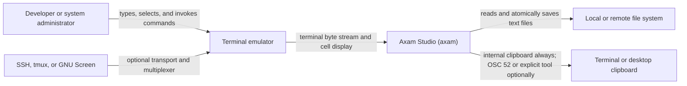
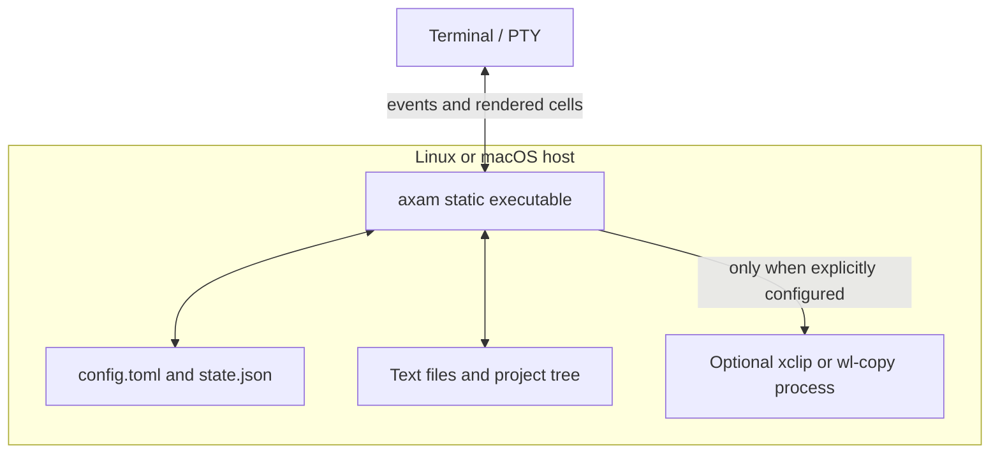
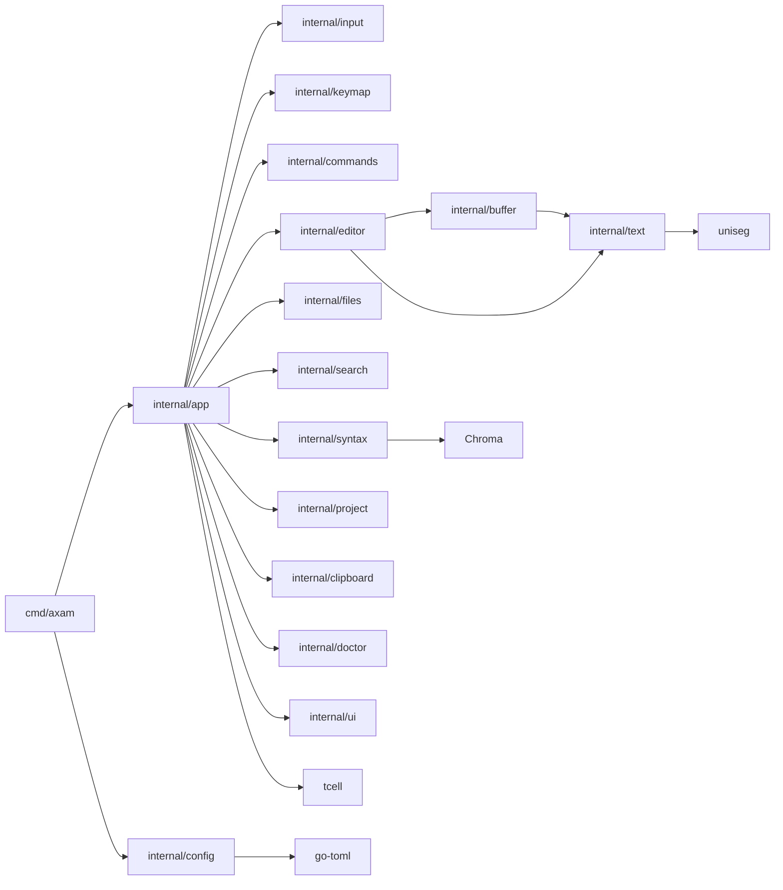
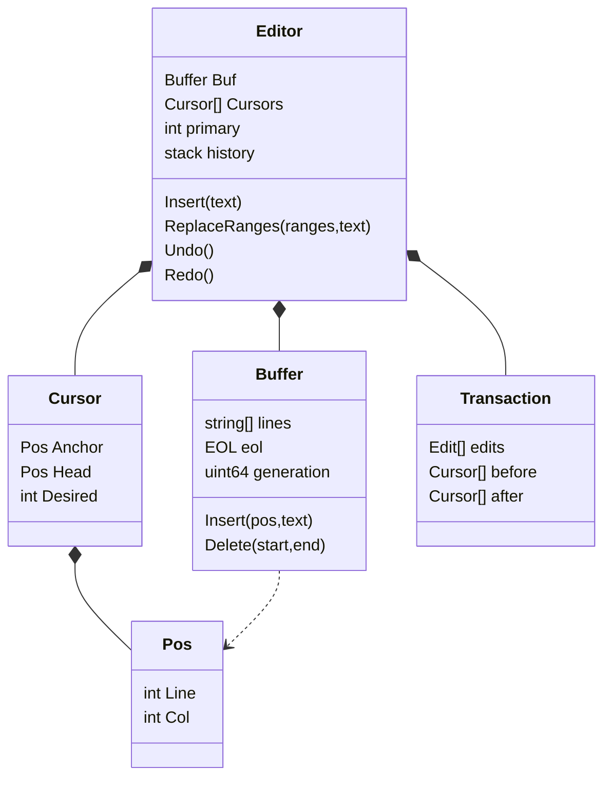
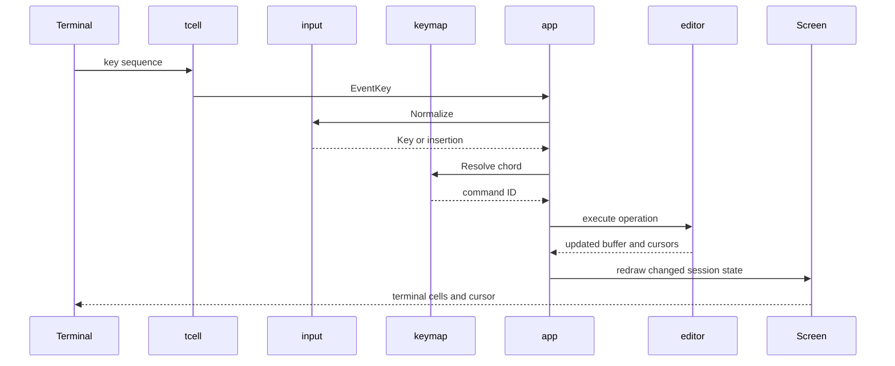

# C4 architecture model

This document describes axam 1.1 with the C4 vocabulary. Mermaid flowcharts
are used instead of a renderer-specific C4 extension so the diagrams work in
GitHub, GitLab, and common Markdown previewers.

## Level 1: system context

axam is the system of interest. The terminal emulator is outside the trust
boundary: it decides which key combinations can reach the process and whether
OSC 52 is accepted. No network service is required for editing.

## Level 2: executable containers

axam deliberately has one runtime container.

There is no browser, daemon, database, plugin host, Node.js runtime, or remote
backend. Debian packaging installs that same executable as `/usr/bin/axam`.

## Level 3: executable components

Responsibilities:

- `cmd/axam` parses flags and subcommands, loads configuration, creates the
  terminal screen, opens arguments, and starts the session.
- `internal/app` owns documents, panes, overlays, the bottom command menu,
  event dispatch, drawing, and the connection between command IDs and editor
  operations.
- `internal/input` normalizes tcell events and provides a deterministic
  xterm/Kitty sequence test harness.
- `internal/keymap` stores profile data and resolves one-key and multi-key
  chords. It does not mutate documents.
- `internal/commands` is the stable command-ID catalog shared by keymaps, the
  palette, bottom menu, and tests.
- `internal/editor`, `buffer`, and `text` form the UI-independent editing
  core. They own selections, transactions, document lines, grapheme
  boundaries, wrapping, and visual columns.
- `internal/files` owns decoding, binary and size guards, disk-change checks,
  backups, and atomic save preparation.
- `search`, `syntax`, and `project` provide pure or bounded supporting
  operations.
- `config`, `clipboard`, and `doctor` isolate host integration.
- `ui` contains terminal color palettes; layout remains in `app`.

## Level 4: editing core

`Pos.Col` is a grapheme-aligned byte offset, not a rune index or display
column. `Desired` stores a visual terminal-cell column during vertical
movement. This separation is the core correctness invariant.

## Dynamic view: one key press

The bottom menu and command palette join this sequence at the command-ID
step. They do not contain alternative editing implementations.

## Deployment view

Release builds set `CGO_ENABLED=0` and target Linux amd64/arm64 and macOS
amd64/arm64. The `.deb` archive contains `/usr/bin/axam`, a manual page, and
copyright metadata. The package homepage is
https://github.com/alexshescp/axam. User
configuration and recent-file state are outside the package and survive an
upgrade.
