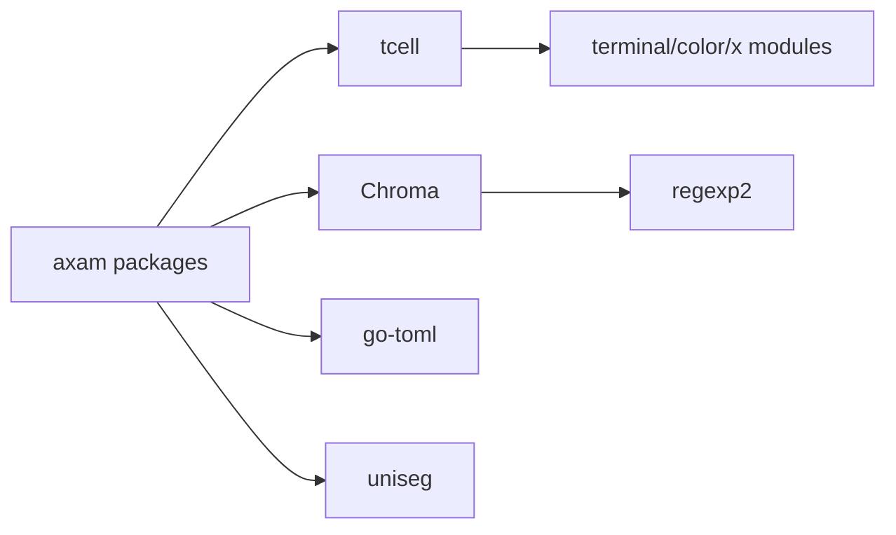

# Libraries and dependencies

Axam Studio 1.1 is the Go module `github.com/alexshescp/axam`. It pins
dependency versions in `go.mod` and hashes module content in
`go.sum`. Release builds use `CGO_ENABLED=0`; none of the direct dependencies
requires a graphical runtime or network service.

The source code and license file in each pinned module remain authoritative.
The license summary below is for release review, not legal advice. Before
publishing a release, run `go mod verify`, inspect the module license files,
and include any notices required by the distribution channel.

## Direct dependencies

### github.com/gdamore/tcell/v2 v2.13.10

Purpose: terminal initialization/restoration, event decoding, cell rendering,
hardware cursor, resizing, focus events, SGR mouse, bracketed paste, OSC 52,
and enhanced keyboard negotiation.

Why selected: a text editor needs exact control over screen cells and raw key
events. tcell exposes those primitives directly and has a simulation screen
for deterministic tests. A widget-oriented framework would not remove the
need for custom cursor, selection, and viewport logic.

Runtime boundary: tcell parses terminal sequences, but axam normalizes the
result and owns bindings and commands. axam does not delegate editing behavior
to tcell.

License in the pinned module: Apache-2.0.

### github.com/alecthomas/chroma/v2 v2.20.0

Purpose: lexical syntax tokenization for Go, Python, JavaScript, TypeScript,
JSON, YAML, TOML, XML, HTML, CSS, Bash, SQL, Markdown, nginx configuration,
and Dockerfile.

Why selected: Chroma is pure Go and supports the required languages. Common
Tree-sitter Go bindings require cgo, which conflicts with the static
cross-build goal.

Runtime boundary: axam tokenizes a visible line and maps Chroma token classes
onto its own terminal theme. Highlighting is presentation only and cannot
modify the buffer. Per-line tokenization means multiline strings can be
colored incorrectly.

License in the upstream/pinned distribution: MIT.

### github.com/pelletier/go-toml/v2 v2.2.3

Purpose: decode the human-editable `config.toml`, reject unknown fields, and
report parse positions.

Why selected: TOML fits editor preferences and bindings better than a
schema-less JSON document, while the v2 decoder provides strict decoding.

Runtime boundary: decoded values are validated by `internal/config` before
they enter the session.

License in the pinned module: MIT.

### github.com/rivo/uniseg v0.4.7

Purpose: Unicode grapheme segmentation and terminal cell-width calculation.

Why selected: cursor movement must not split combining sequences or emoji, and
terminal columns cannot be computed from byte or rune counts.

Runtime boundary: document positions remain grapheme-aligned byte offsets.
uniseg supplies segmentation and width; axam owns tabs, wrapped rows,
selection anchors, and desired columns.

License in the upstream/pinned distribution: MIT.

## Transitive dependencies

These are not imported as architectural APIs by axam:

- `github.com/dlclark/regexp2 v1.11.5`: used by Chroma lexers.
- `github.com/gdamore/encoding v1.0.1`: terminal character encoding support
  used by tcell.
- `github.com/lucasb-eyer/go-colorful v1.3.0`: color conversion used by tcell.
- `golang.org/x/sys v0.38.0`: operating-system terminal and signal primitives.
- `golang.org/x/term v0.37.0`: terminal capability primitives.
- `golang.org/x/text v0.31.0`: character encodings and Unicode data.

The expected licenses are permissive (MIT, Apache-2.0, or BSD-family), but
release review checks the actual module files instead of relying on this
summary.

## Standard library use

Important standard packages include:

- `os`, `io`, `path/filepath`, and `crypto/sha256` for file identity and
  safety;
- `archive/tar`, `compress/gzip`, and a small `ar` writer for Debian packages;
- `regexp` for document and project search;
- `os/exec` only for explicitly configured `xclip` or `wl-copy`;
- `context` for bounded project operations;
- `os/signal` for clean terminal shutdown.

No shell command is executed when opening or rendering a document.

## Dependency direction

`internal/editor` does not import tcell, Chroma, or TOML. This keeps the
highest-risk correctness logic testable without a terminal.

## Update policy

1. Update one direct dependency family at a time.
2. Review release notes and the module diff; do not use an unbounded `latest`
   version in release automation.
3. Run `go mod tidy` and `go mod verify`.
4. Run unit, simulation, vet, and race checks.
5. For tcell, repeat the manual terminal matrix because key decoding and
   terminal mode changes cannot be validated by SimulationScreen alone.
6. For Chroma, run every supported-language test and inspect viewport
   performance.
7. Rebuild all target binaries and compare package size.
8. Recheck dependency licenses and notices before distribution.

## Supply-chain and reproducibility controls

- Exact versions and cryptographic sums are committed.
- Release builds use `-trimpath` and set the version through a linker value.
- cgo is disabled, avoiding host C-library variation.
- CI builds from a clean module graph and inspects Debian package contents.
- Basic editing performs no network calls.
- A future release pipeline should publish SHA-256 checksums and signatures;
  1.1 does not claim signed artifacts.
