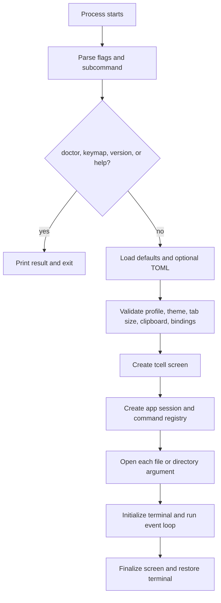
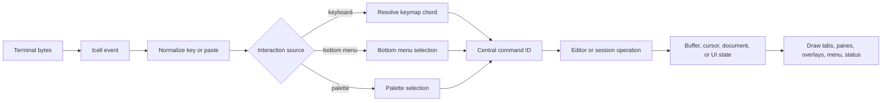
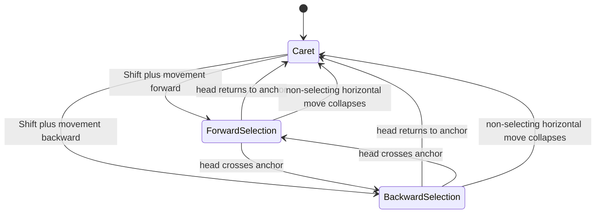
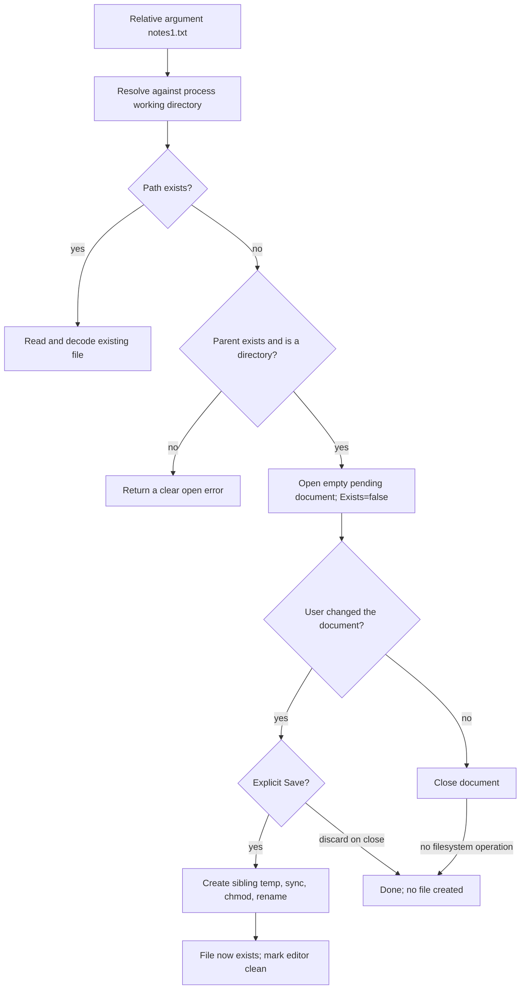
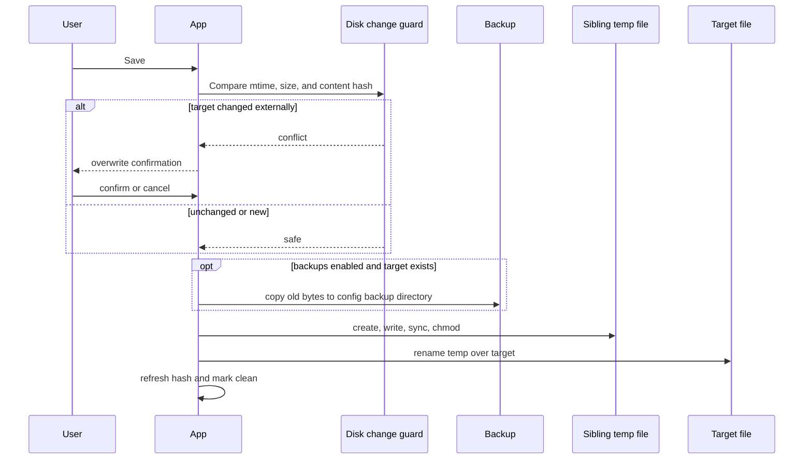
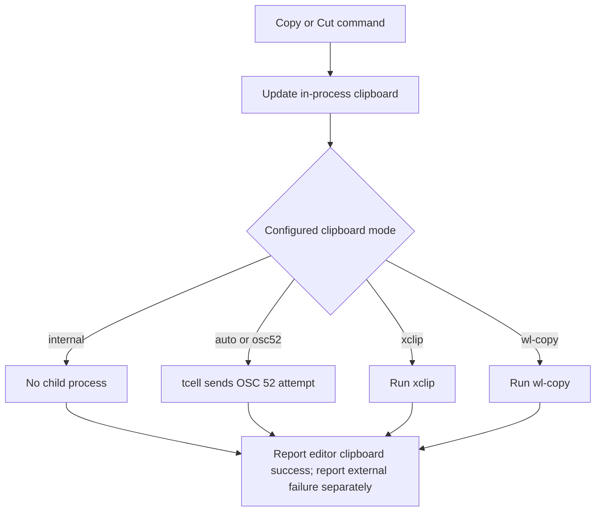
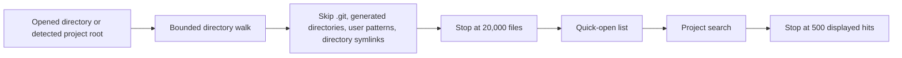

# Runtime and file-safety flows

These diagrams describe axam 1.1 behavior. They are architectural contracts:
tests should fail if an implementation change breaks them.

## Startup

An invalid user configuration fails before raw terminal mode begins. Once
`Run` initializes the screen, `Fini` is deferred so a normal return and a
reported panic restore terminal state.

## Input, command, edit, render

The renderer never interprets editing shortcuts. The menu never edits text
directly. Both properties keep key profile changes independent of editor
logic.

## Anchored selection

The anchor remains fixed in all Shift transitions. Vertical transitions also
retain the desired terminal-cell column through short lines.

## Pending command-line file

`axam notes1.txt` binds an empty document to an absolute path without
creating a directory entry.

Saving an unchanged pending document is still an explicit request and creates
an empty file. Merely opening and closing it does not.

## Atomic save and external-change guard

On Unix, rename-over is atomic. The Windows fallback removes the destination
immediately before rename and therefore cannot make the same atomicity claim.
A save never truncates the target before a replacement is prepared.

## Clipboard paths

OSC 52 transmission is not proof that a desktop clipboard changed. Over SSH,
the local terminal decides whether to accept it.

## Project discovery

Project search skips NUL-marked binary files and files above its per-file
limit. Long operations accept cancellation contexts even though the first
release currently invokes them synchronously from the session.
