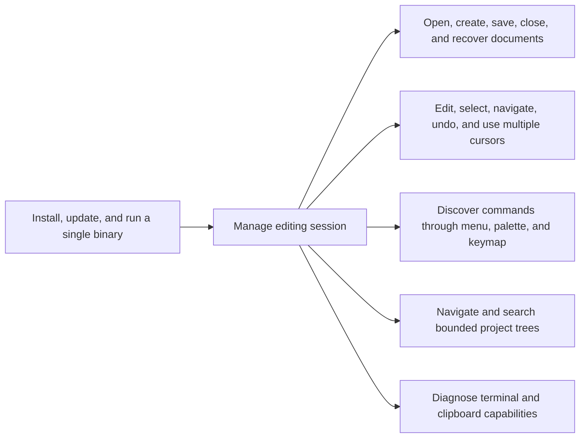
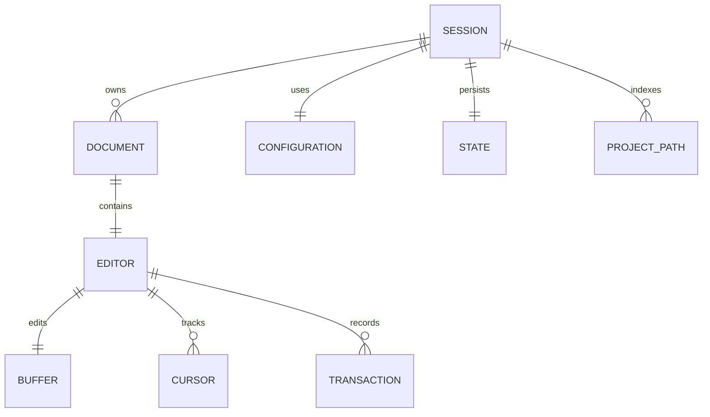
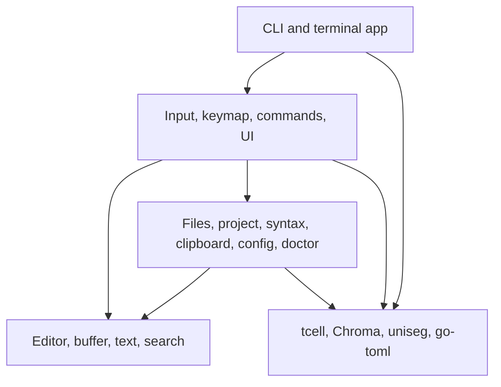
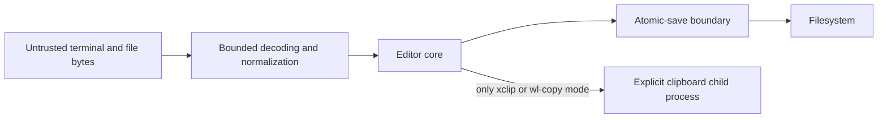
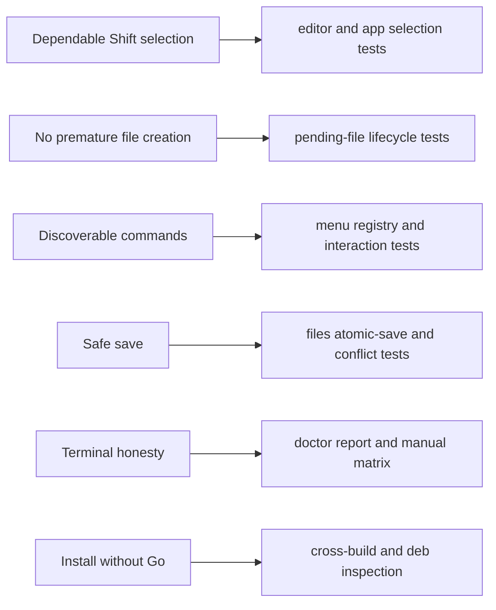

# TOGAF-aligned architecture description

This is a pragmatic mapping of axam 1.1 to TOGAF Architecture Development
Method concepts. It is not a claim of The Open Group certification, a complete
enterprise repository, or conformance with an organization-specific metamodel.
It gives maintainers a common set of viewpoints for decisions and releases.

## Preliminary phase

### Scope and principles

The architecture scope is the axam executable, its user configuration and
state, local files it opens, its release packages, and terminal integrations.
Terminal emulators, SSH servers, multiplexers, operating-system filesystems,
and optional clipboard commands are external systems.

Architecture principles:

1. Editing correctness outranks decorative UI.
2. Terminal limitations are reported, never disguised as successful input or
   clipboard operations.
3. One command implementation serves keyboard bindings, the command palette,
   the bottom menu, and tests.
4. Bytes, grapheme boundaries, logical lines, wrapped rows, and terminal cells
   remain distinct coordinate systems.
5. The original file is not truncated before a replacement is prepared.
6. Basic editing is local, offline, modeless, and independent of a graphical
   environment.
7. Release binaries remain reproducible and cgo-free.

### Governance

Changes that affect persisted data, file integrity, key interpretation,
selection semantics, terminal modes, or the central command registry require:

- unit or simulation tests;
- an update to the relevant architecture or compatibility document;
- an ADR when the change introduces a durable trade-off;
- `go test ./...` and `go vet ./...`;
- race testing in Linux CI;
- cross-build and package inspection for a release.

## Phase A: architecture vision

### Stakeholders

- Developers editing source and configuration over local terminals or SSH.
- System administrators editing service configuration on headless servers.
- Maintainers evolving the editing engine, TUI, and packages.
- Release engineers distributing static binaries and Debian packages.
- Security and operations reviewers concerned with file integrity, terminal
  restoration, dependency provenance, and privileged editing.

### Outcomes

axam should feel familiar to users of modeless graphical editors while being
honest about the terminal protocol. It must open and save real files safely,
provide dependable anchored Shift selection, remain usable at 80x24, and be
installable without a Go toolchain.

### Constraints

- A terminal transmits bytes, not native desktop keyboard objects.
- Command/Super keys and some Ctrl+Shift combinations may be intercepted or
  collapsed.
- Terminal cell width differs from byte and rune counts.
- Basic editing must not depend on a network, daemon, or GUI clipboard.
- Static cross-compilation excludes cgo-dependent parsing engines.

## Phase B: business architecture

### Capabilities

### Value stream

1. User invokes `axam` with zero or more file/directory paths.
2. The session opens existing files or binds missing filenames as pending
   documents without creating them.
3. The user edits through normalized terminal input or invokes commands from
   the bottom menu or palette.
4. The editor preserves Unicode boundaries and records logical undo
   transactions.
5. Explicit Save performs conflict detection, optional backup, and atomic
   replacement where the platform supports it.
6. Quit restores terminal state and persists only recent-file/project state.

## Phase C: information systems architectures

### Data architecture

Primary data entities:

- **Document**: path, display name, encoding, BOM, permission, disk identity,
  language, fold state, and an Editor.
- **Buffer**: logical lines without line-ending bytes, preferred EOL style,
  mixed-EOL flag, and generation number.
- **Cursor**: selection anchor, active head, and desired visual column.
- **Transaction**: ordered edits plus cursor snapshots before and after.
- **Configuration**: validated user preferences and key overrides.
- **State**: recent files and projects; deliberately separate from editable
  configuration.
- **Project index**: bounded, transient path list; not a persistent database.
- **Clipboard**: transient in-process text plus optional external transfer.

Data lifecycle and protection:

- File bodies are untrusted input. They are displayed and searched, never
  executed.
- UTF-16 BOMs and invalid UTF-8 bytes are round-tripped where possible.
- Mixed line endings are normalized to the majority style and disclosed.
- Binary files are refused; files above 256 MiB need explicit `--force`.
- Recent paths contain metadata, not file content.
- Pending documents do not become filesystem objects until explicit Save.

### Application architecture

The single executable is decomposed into packages with inward dependencies:

The editing domain has no terminal dependency. The application layer adapts
key events and menu selections into command IDs, then invokes domain
operations. See [C4.md](C4.md) for package-level detail.

## Phase D: technology architecture

### Runtime platform

- Go 1.26.3 module, cgo disabled for release builds.
- Linux and macOS on amd64 and arm64; a Windows binary is also built for
  development validation.
- UTF-8 terminal, with graceful 16/256/true-color rendering.
- tcell for terminal setup, event decoding, cell rendering, mouse, bracketed
  paste, enhanced keyboard negotiation, and OSC 52 transmission.
- Local filesystem for documents, backups, configuration, and state.

### Technology standards

- TOML for user configuration; JSON for internal recent-path state.
- Go tests and SimulationScreen for deterministic UI tests.
- Mermaid inside Markdown for portable architecture diagrams.
- Debian `ar` plus `tar.gz` package layout generated without requiring dpkg.
- GPL-3.0-or-later for axam; dependency licenses are reviewed separately.

### Security boundaries

axam does not invoke shells when opening files. Optional clipboard tools use
fixed executables and arguments, and only when explicitly configured.

## Phase E: opportunities and solutions

Implemented building blocks:

- independent Unicode-aware editing core;
- centralized command architecture and profile keymaps;
- direct terminal UI with tabs, panes, overlays, bottom menu, and status;
- atomic save preparation and external-change detection;
- bounded project traversal and search;
- static cross-platform release and Debian packaging.

Candidate future increments, not current claims:

- a rope or piece table after benchmarks identify line-slice movement as a
  real bottleneck;
- background/cancellable project search with immutable result handoff;
- incremental multiline parsing without compromising static builds;
- recovery journals with documented privacy and cleanup behavior;
- more than two panes after layout and focus semantics are specified.

## Phase F: migration planning

The current baseline is 1.0.0. Release 1.1.0 adds:

1. pending command-line documents and an explicit no-create-before-save rule;
2. an interactive bottom command menu that reuses the command registry;
3. architecture, dependency, operations, and decision documentation;
4. refreshed release binaries and Debian packages.

There is no configuration or file-format migration. Existing `config.toml`
and `state.json` remain valid. Installing the new `.deb` replaces the binary
and manual page but does not remove user state.

## Phase G: implementation governance

Acceptance checks for 1.1:

- `axam notes1.txt` leaves no file after unchanged close.
- Save creates the pending file; explicit Save can create an empty file.
- A missing parent directory produces an error.
- Every visible bottom-menu item maps to a known command and a handler.
- F10, arrows, Enter, Escape, mouse selection, and 80x24 drawing are tested.
- Core selection, Unicode, save, search, syntax, keymap, and packaging tests
  remain green.
- Help, version, keymap, doctor, all target builds, and both `.deb` archives
  are inspected.

## Phase H: architecture change management

The architecture is intentionally evolutionary. A maintainer should create an
ADR when changing a core invariant, storage format, dependency strategy,
terminal protocol policy, menu/command routing, or file-safety guarantee.
Release notes identify limitations that remain, not only features added.

Metrics worth collecting through benchmarks and tests, without telemetry:

- edit latency by line count and line length;
- redraw cell count and frame duration;
- search time and cancellation latency;
- allocation volume for insert/delete/undo;
- package size and dependency changes;
- compatibility outcomes from the manual terminal matrix.

axam sends no usage telemetry.

## Requirements traceability

